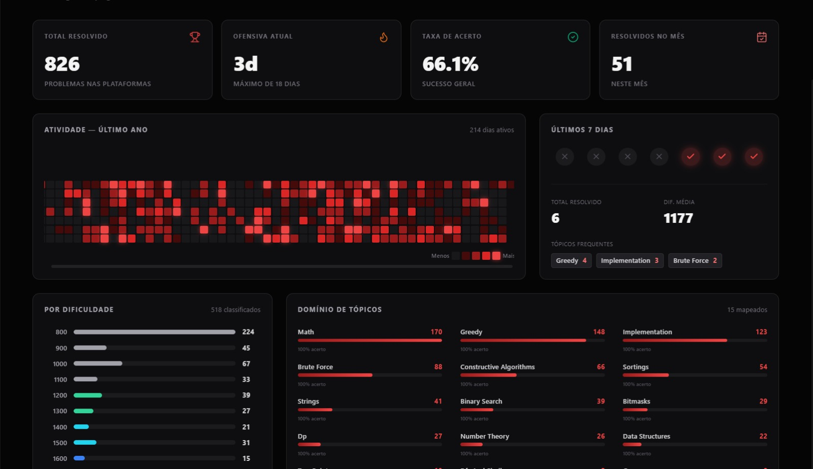
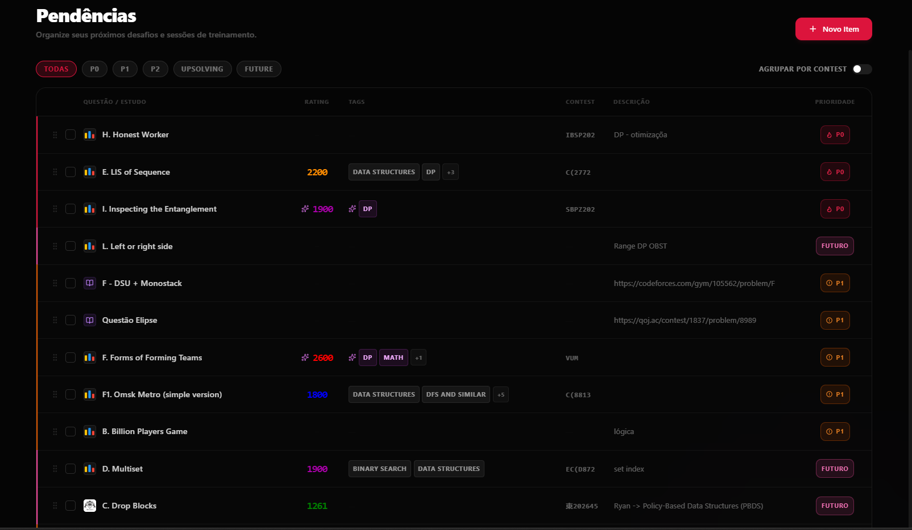
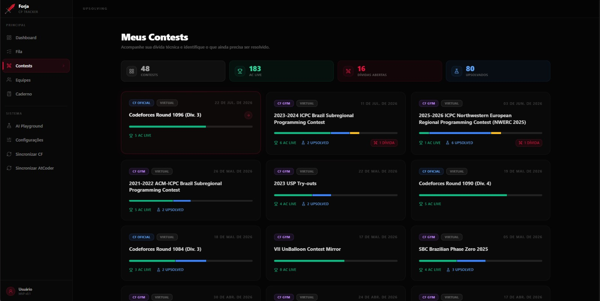

<div align="center">

# Forja

**A full-stack platform for turning competitive programming activity into structured training.**


**[Live Demo](https://forja-cp.vercel.app/)** | **[Technical Highlights](#engineering-highlights)** | **[Roadmap](#roadmap)**

</div>

## Live demo

```text
Username: forja_demo
Password: DemoForja2026!
```

The demo account is populated with public data from [tourist](https://codeforces.com/profile/tourist), one of the most successful competitive programmers of all time. This provides a large, realistic dataset that fully populates the dashboard and its visualizations.

> The data is used for demonstration purposes only. Forja is not affiliated with or endorsed by tourist.

## Why Forja?

Contest history, upsolving debt, study priorities, and performance metrics are usually scattered across platforms, spreadsheets, and notes.

I designed and developed Forja independently to give my three-person competitive programming team a single training workflow. The platform is currently used by all three members to decide what to study next and track progress over time.

## Product preview

### Dashboard



Solved problems, acceptance rate, activity streaks, difficulty distribution, topic performance, and recent contests in one view.

### Study Queue



A drag-and-drop workflow for prioritizing problems and theoretical study sessions, linking them to their source platforms, and tracking completion.

### Contests


A unified view of contest history, live solves, pending upsolving, and post-contest progress across supported platforms.

## What it does

- Synchronizes contests, problems, and submissions from **Codeforces**, **Codeforces Gym**, **AtCoder**, and **CSES**
- Tracks live solves, practice attempts, pending upsolving, and manually reviewed problems
- Organizes problems and study sessions in a priority-based queue
- Builds dashboards from submissions, topics, difficulty levels, streaks, and contest progress
- Separates each user's training data through JWT authentication

## Engineering highlights

- **Multi-platform synchronization:** API clients and scraping services normalize different platform formats into a shared model. Incremental synchronization reduces repeated requests and processing.
- **Problem state machine:** imported submission states and manual review states evolve together without overwriting completed or intentionally deferred work.
- **Analytics and performance:** database aggregations and optimized Django queries generate dashboard metrics while automated tests protect critical API, dashboard, and queue flows.

## AI Lab: evaluation before model selection

The AI Playground includes three saved comparisons on the same **60 reviewed Codeforces problems**, with official ratings from **800 to 2400**:

- Direct classification across Gemini 3.5 Flash-Lite, GPT-OSS 120B and GPT-OSS 20B.
- Rubric prompting across the same three models.
- A paired comparison of both prompts on the selected Gemini model.

With direct classification, Gemini had the lowest observed rating MAE: **255.9 points** versus **394.9** for the median baseline, on the **59 problems with valid ratings across all models**. Tag F1 uses its own common valid subset; coverage, failures and historical calls are reported alongside quality.

On the paired 60-problem Gemini comparison, rubric prompting increased MAE from **256.7 to 268.3**. The product therefore uses Gemini with a versioned prompt derived from direct classification. This is an empirical choice for this sample, not a claim that rubrics always perform worse or that the model is universally superior. Product ratings extend to 3500; quality above 2400 has not been evaluated here.

The runner saves progress, supports bounded retries and resumption, and keeps prompt/configuration hashes. The public views read sanitized snapshots; private statements and raw model responses are not published. The benchmark does not run when a visitor opens the results page.

[Results and limitations](docs/AI_LAB_BENCHMARK_AB_RESULTS.md) · [AI Lab architecture](docs/AI_LAB.md) · [Experiment operations](docs/AI_LAB_EXPERIMENTS.md)

## Architecture and technologies

```text
Codeforces / Codeforces Gym / AtCoder / CSES
                      |
              Sync and scraping services
                      |
React + TypeScript <-> Django Ninja API <-> PostgreSQL
```

- **Frontend:** React, TypeScript, Vite, TanStack Query, Tailwind CSS, DnD Kit
- **Backend:** Python, Django, Django Ninja, JWT, pytest
- **Data:** PostgreSQL em produção, SQLite para desenvolvimento e testes locais

## Desenvolvimento Backend

### 1. Requisitos e Ambiente

- **Versão recomendada do Python:** 3.12 (Python 3.12.10)
- **Ambiente virtual oficial:** `backend\.venv`

### 2. Configuração e Ativação (PowerShell)

```powershell
cd backend
python -m venv .venv
.\.venv\Scripts\Activate.ps1
python -m pip install --upgrade pip
python -m pip install -r requirements.txt
```

### 3. Validação do Django

Para checar a integridade da aplicação localmente:

```powershell
python manage.py check
```

_Nota:_ Comandos normais do Django (`manage.py runserver`, `migrate`, etc.) utilizam o banco de dados configurado no arquivo `backend\.env`.

### 4. Execução de Testes

Os testes automatizados utilizam um ambiente SQLite totalmente isolado em memória (`core.settings_test`), garantindo que a suíte nunca acesse ou afete o banco de produção/Supabase:

```powershell
python -m pytest
```

## Roadmap

- **Team analytics:** aggregated training metrics, member comparisons, and shared upsolving progress.
- **Collaborative notebook:** a shared library for algorithms, templates, snippets, and problem-solving notes.
- **Further classification experiments:** evaluate additional prompting strategies and machine-learning approaches against the existing benchmark before adopting them in the product.

## Author

Designed and developed by **Bernardo Magno**.

- [GitHub](https://github.com/bemagnodev)
- [LinkedIn](https://www.linkedin.com/in/bernardo-magno/)
